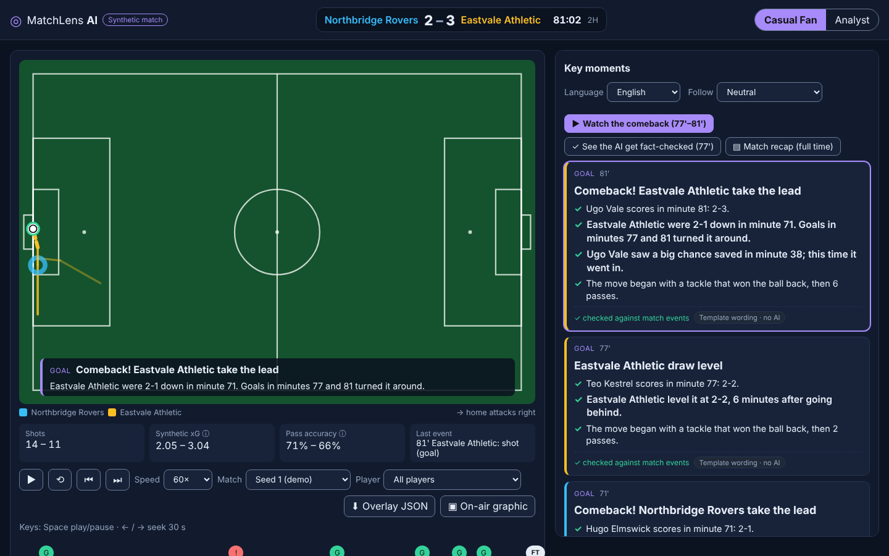
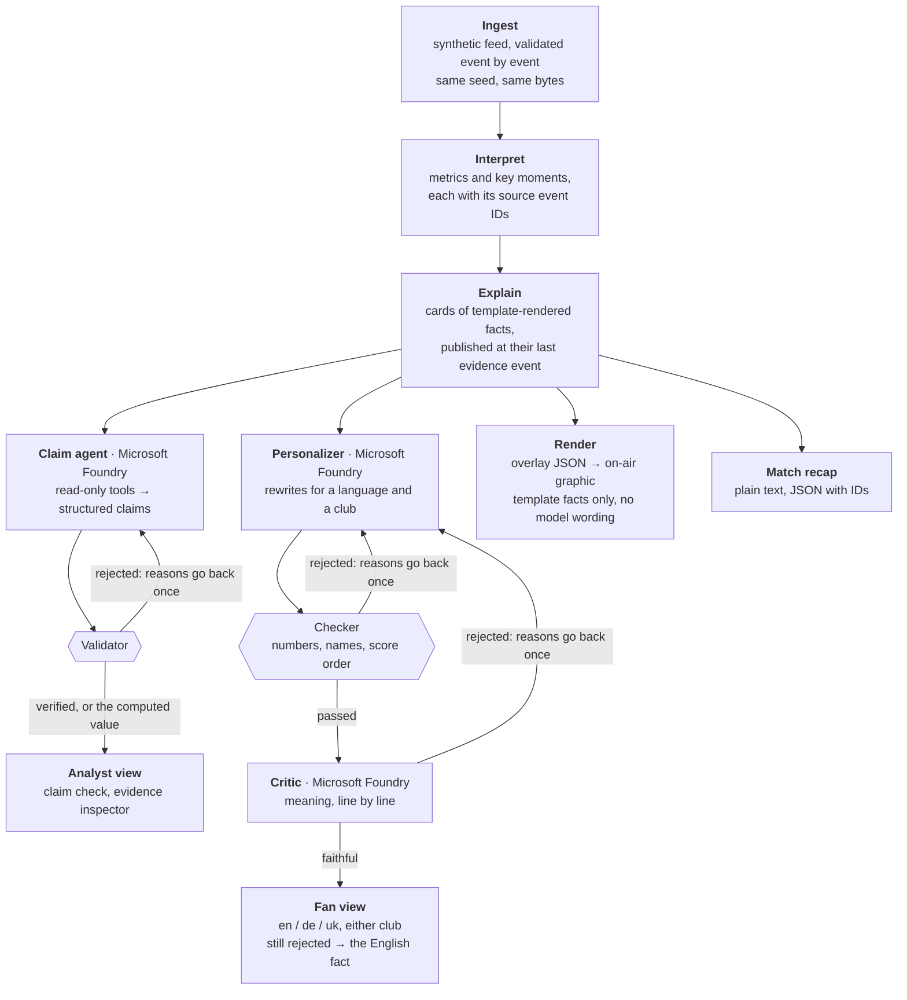
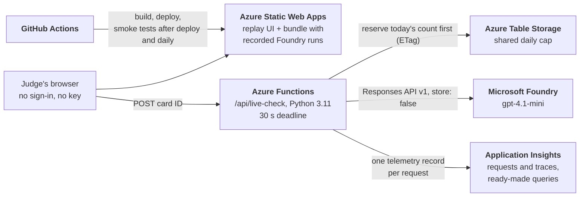
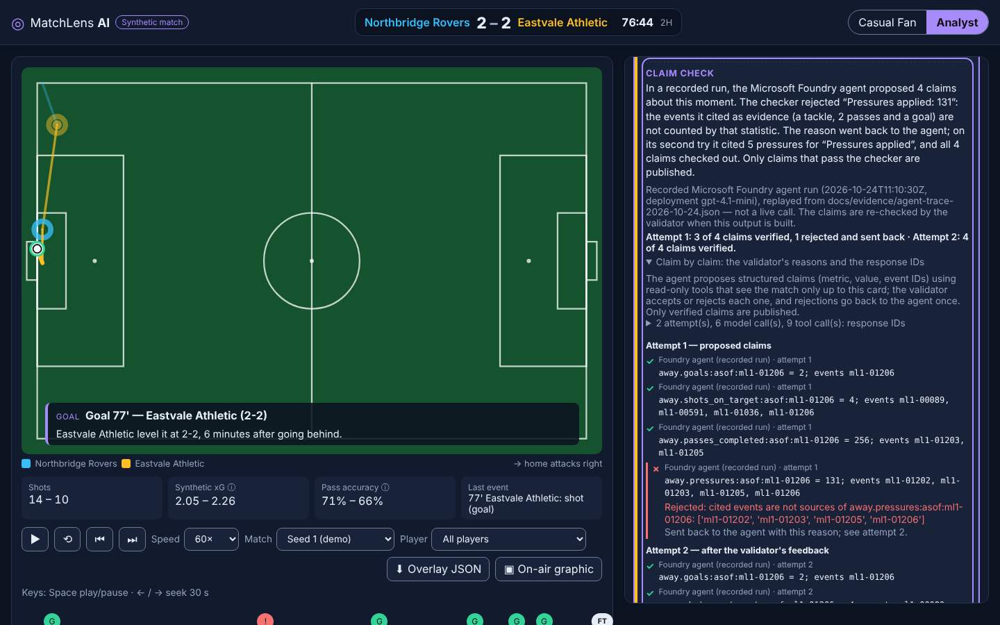
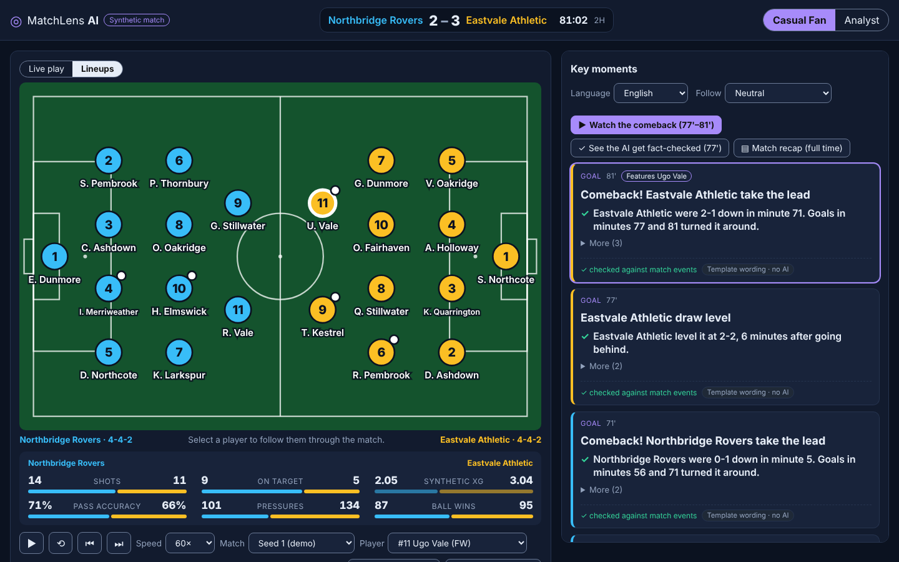
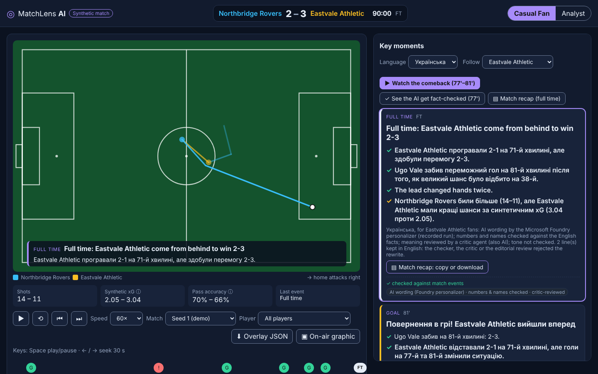
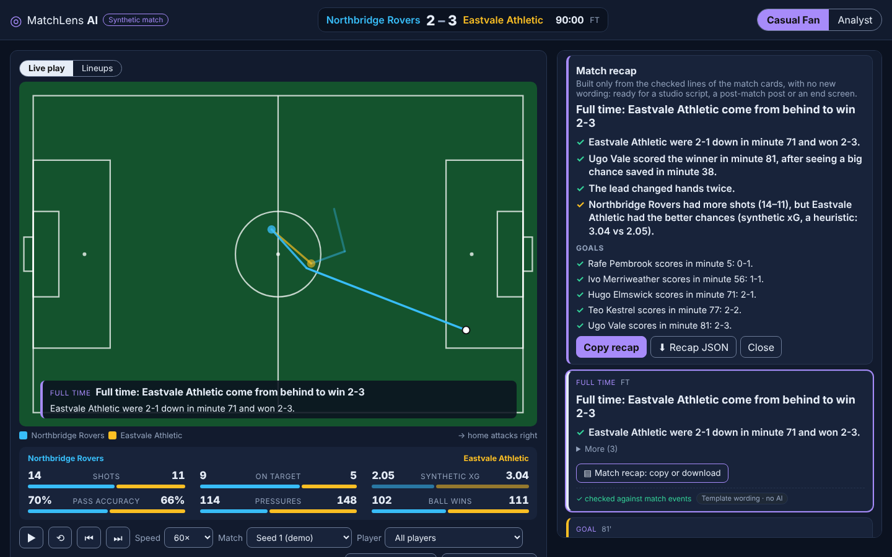
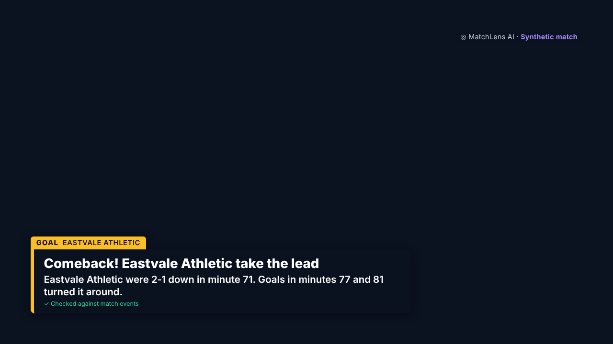

# MatchLens AI

**Explainable match intelligence for broadcasters and fans, from synthetic football events. Every published line cites the events it came from.**

MatchLens is for the people who put words on screen during a match: a studio editor or a stream producer who has to say *why* a moment matters without risking a wrong number on air. It turns a synthetic event stream into cards that explain each key moment, timed overlay cues for a broadcast graphic, a full-time recap, and two genuinely different experiences: one for a casual fan (in English, German or Ukrainian, from either club's side) and one for an analyst.

Facts are rendered from structured data, never written by a model. Three Microsoft Foundry agents work with them. The **claim agent** proposes what an analyst card may assert, and a deterministic validator accepts or rejects each claim. The **personalizer** rewrites fan cards for a language and a club. The **critic** reviews each rewrite for meaning. AI wording is always labelled, and the on-air graphic shows template-rendered facts only.

Built for the Microsoft × Premier League *Inside the Game* Developer Hackathon. Project page: <https://innovationstudio.microsoft.com/hackathons/insidethegamedeveloperhackathon/project/126828>



| | |
|---|---|
| **Live demo, Azure** (free, no sign-in, no API key) | <https://wonderful-hill-04967dd0f.5.azurestaticapps.net/>: Azure Static Web Apps with a managed Azure Functions API for live Foundry checks |
| **Mirror** | <https://vbabenko97.github.io/matchlens-ai/>: GitHub Pages, static only (no live-check button) |
| **Demo video** | <https://youtu.be/4q2mIk0xPjs>: 1 min 38 s, English captions |
| **Microsoft technology** | Microsoft Foundry (Azure OpenAI `gpt-4.1-mini`, Responses API v1, structured outputs, function calling) · Azure Static Web Apps · Azure Functions (managed API, Python 3.11) · Azure Table Storage (shared spend cap) · Application Insights (live-check telemetry) · GitHub Actions |
| **Data** | 100% synthetic, generated by this repository; fictional teams and players; no real match data, footage or club branding |
| **Entered for** | Grand Prize and **Best Enterprise Solution** ([the deployment case](#from-demo-to-production)) |

## What an editor gets

1. **A card for every key moment, never early.** It appears once its last evidence event exists and leads with what changed: an equaliser, a comeback, what a missed chance would have meant.
2. **Every line can be checked.** In Analyst mode each fact opens its events and metrics on the pitch, and the AI's claims show the validator's verdict in plain words.
3. **One set of facts, many audiences.** A fan reads the match at a glance: comparison bars, both lineups and one line per moment, in their language and from their club's side, with the AI wording labelled and checked for numbers and names. An analyst gets every line with its evidence.
4. **Ready for air.** The moment plays as a lower-third (the caption graphic across the bottom of the picture) in a browser source (a web page that streaming software such as OBS or vMix lays over the video), or is exported as timed overlay JSON for a graphics system to read.
5. **A recap at the final whistle.** Copy it as text, or download it with the sources of every line.

## Try the demo

1. Open the [demo](https://wonderful-hill-04967dd0f.5.azurestaticapps.net/) and press **▶ Watch the comeback (77'–81')**. Cards appear as the moments happen: never before the events they cite, and each one leads with why the moment matters.
2. Switch to **Analyst** and press **See the AI get fact-checked (77')**. A short summary says what happened in a recorded Foundry agent run: the validator rejected the claim "Pressures applied: 131" because its evidence was a tackle, two passes and a goal, and the agent's retry cited pressures instead. The claim-by-claim list and the response IDs are below it.
3. On the Azure demo, an analyst card offers **Check this card live with Microsoft Foundry**. It runs the same agent live behind a shared daily cap, or says why it did not.
4. Back in **Casual Fan**, switch the pitch to **Lineups** and select a player to follow them: their goals, their last touch and a badge on every card that cites them.
5. Set **Language: Українська** and **Follow: Eastvale Athletic** ([direct link](https://wonderful-hill-04967dd0f.5.azurestaticapps.net/?t=5400&lang=uk&follow=away)). Each line the personalizer agent rewrote is checked against the English fact, then reviewed for meaning by the critic agent; the lines that failed, and the lines two AI editorial reviews rejected, stay in English, marked as such. Each card leads with one line; **More** opens the rest.
6. Press **▤ Match recap (full time)**: the full-time story and the scorers as one text, built only from the checked card lines. **Copy recap** gives plain text; **Recap JSON** keeps each line with its event and metric IDs. It follows the language and club you picked.
7. Open **▣ On-air graphic**: a broadcast lower-third fed by the same overlay JSON, ready for an OBS or vMix browser source ([rundown](https://wonderful-hill-04967dd0f.5.azurestaticapps.net/broadcast.html?mode=casual&rundown=1&bg=dark)). The **Match** picker offers five more matches that were not tuned for the demo.
8. With Python 3.11+ (no other dependencies), in a clone of this repository, process a match as a feed: `pip install -e . && python -m matchlens feed --seed 1 --speed 60 | python -m matchlens stream -`. Events arrive one at a time; each is validated on arrival, and each card is printed when its last evidence event arrives.

## How it works



On the public pages the three agents replay recorded live runs, and every build re-runs every check on them; on Azure, the claim agent also runs live on request. A PNG of this diagram is in [docs/images](docs/images/architecture-pipeline.png).

### The five-stage pipeline

Each stage is one of the five in [the challenge, §4.1](https://github.com/microsoft/insidethegamehackathon/blob/main/OFFICIAL%20RULES.md), followed by the code that implements it.

- **Ingest.** A deterministic generator writes a full 90-minute match: passes, shots, tackles, interceptions, recoveries, clearances, pressure events, possession chains and match metadata. An event validator enforces the invariants: unique IDs, nondecreasing clock, score only on goals, possession ownership, ball continuity within 1 m. The same seed (the number that starts the generator's random draws) gives the same bytes. The match can also arrive as a feed: `matchlens feed` writes it one event at a time, and `matchlens stream` validates each event on arrival and publishes each card as its last evidence event arrives, without looking ahead.
  Code: `generator.py`, `validate.py`, `stream.py`, [DATA_MODEL](docs/DATA_MODEL.md).
- **Interpret.** Metrics with stable IDs, full-match and 15-minute windows (passes, completion, shots, on target, goals, pressures, turnovers, possessions, synthetic xG), each listing its source event IDs; xG (expected goals) is a shot's estimated chance of scoring, here from its distance and angle. Key moments: every goal, every missed big chance, full time.
  Code: `metrics.py`, `moments.py`.
- **Explain.** Match-story lines say why a moment matters (opener, equaliser, comeback, back in front, redemption, what a missed chance would have meant, how the match was won). Each line cites events and is re-rendered from those events alone before it is published.
  Code: `story.py`, `cards.py`.
- **Render.** A card is published at its last evidence event, never earlier. Timed, machine-readable overlay cues (`matchlens.overlays/v1`, both modes); a transparent broadcast lower-third that plays them; a match recap at full time (`matchlens.recap/v1`) to copy as text or download with its sources; a replay UI with pitch view, timeline and scoreboard.
  Code: `overlays.py`, `recap.py`, `web/`.
- **Personalize.** Casual and Analyst are different experiences. Casual reads at a glance: comparison bars, both lineups with a player to follow, one line per moment. Analyst shows event chains, metric chips, an evidence inspector and the claim check. Fans also pick a language (en/de/uk) and a club, rewritten by the personalizer agent, checked line by line and reviewed by the critic agent.
  Code: `narrative.py`, `personalize.py`, `web/app.js`.

## From demo to production

MatchLens is entered for **Best Enterprise Solution**. This is the deployment case: the controls that already work, how the demo runs on Azure, and what a first pilot would add and measure.

### Controls already in place

| Risk | Control | Code |
|---|---|---|
| A model states a wrong number or name | Facts are rendered from structured data by templates. The claim agent proposes structured claims (metric, value, event IDs) that the validator accepts or rejects. A rewrite must keep every number, score pair (home first) and name of its English fact. | `claims.py`, `agent.py`, `personalize.py` |
| A rewrite changes the meaning | A critic agent reviews each line that passed the checker; a missing verdict is a rejection; a line still rejected shows the English fact. The critic is a model and misses errors ([measured](#the-critic-measured)). | `critic.py` |
| Look-ahead and spoilers | A card is published at its last evidence event. The claim agent's tools see the match only up to that event. The recap appears only at full time. Fed one event at a time, every match gives the same cards at the same events: checked on 31 seeds in the tests and on every match at every build. | `cards.py`, `agent.py`, `recap.py`, `stream.py` |
| A broken feed | The stream processor checks each event on arrival with the event validator's rules. The first invalid event stops publishing for the rest of the stream. | `validate.py`, `stream.py` |
| AI output taken for fact | AI wording is labelled wherever it appears. The on-air graphic shows template facts only. Synthetic xG and xPass (expected pass completion: a pass's estimated chance of arriving) are labelled as heuristics. | `web/` |
| No audit trail | Live runs are recorded with response IDs and token use, and every build re-checks them. Editorial rejections, from AI reviews that no human has checked, are kept with reasons in a versioned file that the build applies to the exact text. | `docs/evidence/` |
| Runaway cost from a public page | The live endpoint takes a card ID only. A shared daily cap is reserved in Azure Table Storage before any model call; if the store fails, no call is made. | `live.py`, `quota.py` |
| Exposed secrets and stored data | The browser never holds a key: live checks run in an Azure Function. Every Foundry call is made with `store: false`. The data is synthetic, with no personal data. | `live.py`, `api/` |
| Silent breakage | Playwright smoke tests run after every deploy and daily on both hosts through the end of judging. They never press the paid live-check button, so the live call is checked by hand. | `.github/workflows/` |
| No view of the live endpoint in use | Each live-check request, refused or not, writes one telemetry record: outcome and fallback reason, timing, model calls, tokens and HTTP 429 answers (also for a run that fails half-way), claims rejected per attempt and response IDs. The Functions host sends it to Application Insights (`traces`), connected on the Azure host since 2026-10-25 ([screenshot](docs/images/telemetry.png)); server-side failures log at Warning, so an alert can watch them. No key, client address or request text is logged. Ready-made queries: [telemetry.kql](docs/telemetry.kql). | `live.py`, `api/host.json` |

### How the demo runs on Azure



### A first pilot

- **User:** a studio editor or stream producer, during and after a match.
- **First use:** explanations of key moments, and the post-match recap.
- **Input:** the provider's event feed, through an adapter to the MatchLens event schema ([DATA_MODEL](docs/DATA_MODEL.md)). In this hackathon the events are synthetic. The stream processor takes them one at a time; an adapter for a real feed is not built yet.
- **Output:** cards with their sources, overlay JSON for the graphics system, the browser-source lower-third, and the recap.
- **A person in the loop:** an editor accepts or rejects rewritten lines. The mechanism exists today: rejections are recorded with reasons in a versioned file that the build applies to the exact text.
- **What to measure:** factual errors that reach air; the share of AI rewrites rejected by the checker, the critic and the editor; editor corrections per match; time from a moment to its card, and to a ready recap. These are the pilot's questions, not results: none of them has been measured yet.

### Before production

- An adapter from a provider's feed to the MatchLens event schema, and the stream processor behind a service the page can subscribe to. Event-by-event processing exists (`matchlens stream`), but the web demo replays a precomputed match.
- Keyless authentication to Foundry with Microsoft Entra ID instead of an API key in the app settings, and real user authentication on the live endpoint instead of the forgeable per-visitor limit.
- Alert rules and a dashboard on the telemetry, and tracing through each Foundry call: the live check sends one record per request to Application Insights and comes with ready-made queries, but no alert is set up, and the static pages send no telemetry at all.
- A native-speaker review for each language before rewrites go out, and a check of tone, which nothing in the pipeline does today.

## How MatchLens meets the judging criteria

### Technological implementation
- **Synthetic data, built for checking.**
  - The generator models event structure (possession chains, restarts, ball continuity, pressure as off-ball events) so every derived claim can be traced to events.
  - xG is a labelled synthetic heuristic, never presented as calibrated.
  - Known simplifications are listed in [DATA_MODEL](docs/DATA_MODEL.md).
- **Engineering practice.**
  - 600+ automated tests, including unit tests and Playwright end-to-end tests on two local hosts (the app server and a static export under a sub-path). The same e2e suite runs against each public URL after every deploy (the smoke tests), and daily on both hosts through the end of judging.
  - CI runs on Python 3.11 and 3.13 with `ruff`.
  - No runtime dependencies (stdlib only); the Azure Functions adapter adds `azure-functions` on Azure.
  - Deterministic seeds, and no secrets in the repository or the redacted evidence files.
- **Microsoft platform.**
  - Foundry through the Responses API v1, with function calling (the claim agent's read-only tools) and strict JSON-schema outputs (all three agents). Every call is made with `store: false`.
  - Azure Static Web Apps hosts the site and a managed Azure Functions API (`api/`).
  - Azure Table Storage holds the shared daily quota.
  - Application Insights collects one telemetry record per live-check request: outcome, timing, tokens, claims rejected per attempt ([queries](docs/telemetry.kql)).
  - GitHub Actions builds, deploys and smoke-tests both hosts.
- **Cost and safety controls on the live endpoint.**
  - The endpoint accepts only a card ID, so it is no general model proxy; JSON POST only.
  - One run at a time, a 30 s deadline over all calls and retries, and a per-visitor courtesy limit.
  - The daily cap is reserved in Azure Table Storage **before** any model call with ETag concurrency. If the store fails, no call is made.

### Agentic design and innovation
- **Three agents, distinct roles, one shared state.**
  - The **claim agent** (analyst cards) explores the match through three read-only tools that only see events up to the card's publication. It proposes structured claims: metric ID, value, cited event IDs; never free text.
  - The **personalizer agent** (fan cards) rewrites already verified facts for a language and a club.
  - The **critic agent** reads each rewrite next to its English fact and returns a structured verdict per line: faithful or not, the kind of problem (added detail, changed meaning, overstatement, language) and a reason.
  - All three work from the same verified card state. The deterministic checks run first; the critic only sees lines that already passed them, and a missing verdict counts as a rejection.
- **The model proposes, the validator decides.**
  - Rejections go back to the agent once, with machine-readable reasons; the recorded runs show real recoveries. The claim agent re-cited the right events at 77'; the personalizer fixed an added number and an added club name, and the checker rejected a transliterated player name. In the published fan run the critic sent 36 lines back at the first attempt; on the second attempt, which also retries the lines the checker sent back, 40 lines were verified.
  - Still-rejected output is dropped (claims) or replaced by the English fact (personalizer). The claim agent's facts are rendered from templates, so that agent chooses *what* to claim, never the wording. The personalizer does write wording, which is why its lines are labelled as AI wording.
- **Readable for people, not only for engineers.** Each claim check opens with a few plain sentences built from the verdicts, never by a model: what the agent proposed, what the validator rejected and why, and how the retry ended.

  
- **Failure recovery throughout.** HTTP 429 waits per `Retry-After`, bounded network retries, a forced final answer when the tool budget runs out, and one resend when an answer is cut off. Every fallback is labelled: the page never presents a fallback as a live response.
- **Recorded runs as evidence.**
  - Live runs are recorded as redacted traces ([claim agent](docs/evidence/agent-trace-2026-10-24.json), [personalizer with critic](docs/evidence/personalize-trace-v2-2026-10-24.json), [critic evaluation](docs/evidence/critic-eval-2026-10-24.json), [connectivity check](docs/evidence/azure-check-2026-10-24.json)) with response IDs and token usage.
  - Each public build replays them and re-runs every check, so a stricter checker applies to old runs too.
  - Example: reading the personalizer run showed flipped scores ("перемагають 3-2" on a 2-3 scoreboard). The checker now enforces home-first score order, and those lines fall back to English. Meaning drift that no deterministic check can see led to the critic agent; an editorial review (done by Claude Code, the AI coding assistant, not checked by a human) still rejects what the critic misses, with reasons in a versioned file the build applies to the exact text. See [the critic's results](#the-critic-measured), including what it does not catch.

### Real-world impact and applicability
- **For broadcasters.** Overlay cues are timed in match seconds, carry their facts and evidence IDs, and are published only once their evidence exists. The stream processor publishes the same cards as events arrive (`matchlens feed | matchlens stream -`); an adapter for a real provider feed is not built yet. The on-air page is a working browser source today.
- **For fans in any market.** The same verified facts reach a German or Ukrainian fan of either club. Nothing the checker cannot verify in numbers and names is shown as a rewrite.
- **For editorial trust.** Every line is traceable to event IDs, AI wording is always labelled, and heuristics are labelled as heuristics. This is the control a newsroom or a league would need before letting a model write on screen.
- **Production path.** Static hosting plus one small serverless function with fail-closed spend controls, and smoke tests after every deploy and daily. The controls, a pilot plan and the gaps before production are in [From demo to production](#from-demo-to-production); operator steps are in [DEPLOYMENT](docs/DEPLOYMENT.md).

### User experience and presentation
- Two modes that differ in substance, not just in density.
  - **Casual Fan** reads at a glance: comparison bars instead of tables, both lineups on the pitch (select a player to follow them), and one line per moment, with **More** for the rest.
  - **Analyst** shows every line with its events and metrics, the claim check and the passing table.
  - Shortcuts take a judge to the turning point, to the AI fact-check and to the full-time recap without watching 90 minutes.

  

  | Fan view in Ukrainian, following Eastvale | Match recap at full time |
  |---|---|
  |  |  |
- Accessibility target WCAG 2.2 AA ([audit](docs/ACCESSIBILITY.md)):
  - axe-core: 0 violations in the audited states, including the lineups, the comparison bars, the match recap and the claim-check summary;
  - keyboard operation, reflow down to 320 px, `lang` attributes on rewritten lines.
  - A screen-reader pass with real assistive technology is still open.
- Demo video (1 min 38 s): <https://youtu.be/4q2mIk0xPjs>.

### Adherence to the hackathon categories
MatchLens is entered for the Grand Prize and for Best Enterprise Solution; the other category prizes are listed for the judges' reference.

| Category | How MatchLens fits |
|---|---|
| **Grand Prize** (explainable match intelligence, narratives, personalized experiences for fans, analysts and broadcasters) | All five pipeline stages, both audiences, broadcast output, a full-time recap, multi-language storytelling ([challenge §4.1 (vi)](https://github.com/microsoft/insidethegamehackathon/blob/main/OFFICIAL%20RULES.md)) |
| **Best Enterprise Solution** (entered) | Controls a broadcaster or league would need before a model writes on screen: template-rendered facts, validator- and critic-gated AI output, labelled AI wording, an audit trail of recorded runs, fail-closed spend control, and a pilot plan with stated gaps ([From demo to production](#from-demo-to-production)) |
| Best Use of Microsoft Foundry | Three Foundry agents (tools, structured outputs), recorded and live runs with response IDs, validator-gated publishing |
| Best Multi-Agent System | A claim agent, a personalizer and a critic with distinct roles, shared verified state, validator and critic handoffs, retries and labelled fallbacks |
| Best Azure Cloud Native Integration | Static Web Apps + managed Functions + Table Storage quota, CI/CD with post-deploy smoke tests |

## Honest limits
- The web demo replays a precomputed match. The stream processor (`matchlens stream`) does take the events one at a time from a feed and gives the same cards at the same events, checked at every build. But it runs from the command line: the web page does not run it live, and there is no adapter for a real provider's feed. Video auto-eventing, player speed and ball speed are not modelled.
- The synthetic data is football-realistic in structure: 11-a-side squads with positions, possession chains, passes, pressures, tackles, shots, scores and pitch coordinates over two halves. Its dynamics are simplified (no fouls, set pieces beyond restarts, substitutions or player skill; see [DATA_MODEL](docs/DATA_MODEL.md)), and its rates are tuned only to look plausible. Synthetic xG is an uncalibrated heuristic. Synthetic xPass is built from the generator's own pass rules, so it matches the simulated outcomes by construction (within 1 % over seeds 100–129) and proves nothing about real football. The generator gives players no passing skill, so "completed minus xPass" is luck. Ball speed is not shown: event times are drawn at random, independent of distance.
- The live Foundry check covers the demo match's analyst cards only. Elsewhere the demo match replays recorded runs (claim agent, personalizer and critic); the five extra matches use a deterministic claim proposer and template wording, with no AI at all.
- The personalizer checker verifies numbers, score order, names, `xG` and script, not meaning. The critic reviews meaning but is a model too: it misses errors and raises false alarms (measured below), and it does not check tone. The page says so on every rewritten card.
- Two editorial reviews of the published run ([file](docs/evidence/personalize-review-v3-2026-10-25.json)) rejected 30 lines that passed both the checker and the critic. Both reviews were done by AI, and no human has checked either one:
  - Claude Code (the AI coding assistant) rejected 12, mostly German and Ukrainian language errors;
  - a second model (ChatGPT, run by the project's operator) read the 68 Ukrainian lines that were left and rejected 18, mostly football phrases translated word for word, plus one added detail ("підкат" for a tackle).

  Those lines show the English fact, so 50 of the 87 Ukrainian lines remain rewrites. The recorded trace itself is unchanged. No native speaker has reviewed the German or Ukrainian text.
- The per-visitor limit relies on forgeable headers. The spend cap is the shared daily count.
- Microsoft Agent Framework, MCP and Fabric are not used; the agents call the Responses API directly.

## Run it locally

```bash
git clone https://github.com/vbabenko97/matchlens-ai && cd matchlens-ai
python -m venv .venv && . .venv/bin/activate
pip install -e .
# What the public build serves: seed 1 (2-3) with the recorded Foundry runs, plus five extra matches
python -m matchlens serve --offline \
  --agent-trace docs/evidence/agent-trace-2026-10-24.json \
  --personalize-trace docs/evidence/personalize-trace-v2-2026-10-24.json \
  --editorial-review docs/evidence/personalize-review-v3-2026-10-25.json
# then open http://127.0.0.1:8000/
```

Run it from the repository root. With `--offline` no Azure call is made: the agents' recorded runs are replayed and re-checked. Plain `python -m matchlens serve` loads no recorded run, so it shows only template wording, labelled as such, with no Language and Follow choice and no recorded claim check; without `--offline` it also uses Azure credentials when they are set. Options: `--seed N`, `--file match.jsonl`, `--port`, `--offline`, `--single-match`, `--agent-trace`, `--personalize-trace`, `--editorial-review`, `--live-api`. `python -m matchlens export-site --out site/` with the same options writes the same UI as a static folder.

```bash
pip install -e ".[dev]"
python -m pytest -q && ruff check . && ruff format --check .
pip install -e ".[e2e]" && python -m playwright install chromium && python -m pytest -q -m e2e

python -m matchlens generate --seed 42 --out match.jsonl   # full 90-minute synthetic match
python -m matchlens validate match.jsonl                    # format + invariant checks
python -m matchlens metrics match.jsonl                     # event-grounded metrics as JSON
python -m matchlens moments match.jsonl                     # card moments with evidence IDs
python -m matchlens cards match.jsonl --mode casual         # verified insight cards (--json, --offline)
python -m matchlens overlays match.jsonl --out overlays.json # timed overlay cues, both modes
python -m matchlens recap match.jsonl                       # full-time recap as text (--json: with IDs)
python -m matchlens feed --seed 1 --speed 60 | python -m matchlens stream -   # a feed, processed as it arrives
```

**Event by event.** `feed` writes the match record and then one event per line, flushed, waiting between events as the match clock does (`--speed 60`: one match minute per second; `0`: no waiting). `stream` reads a file or standard input line by line.
- **Validation on arrival.** Each event is checked with the event validator's rules (`EventValidator`; `validate_match` runs the same checks over a whole match). The first invalid event stops publishing.
- **When cards are built.** When an event can complete a key moment (a shot, the event after a shot, the final whistle), the moments are detected again on the events received so far, and each complete moment gets its cards from those events alone. A missed big chance waits one event, because the next event may answer the shot.
- **Output.** Each published card is printed with the event that completed it; `--json` gives one record per card. No model is called per event.
- **Checked against the batch build.** On seeds 1 and 100–129 every card equals the batch card and is published as its last evidence event arrives (no extra wait); each build of the page repeats that check and fails on any difference.

## The replay UI

The replay UI has a scoreboard, a pitch view of the latest ball events, a timeline with key-moment markers, and insight cards that appear as moments happen.
- **Controls.** Play, pause, seek, previous/next moment and speed (15×–240×). Keyboard: Space plays or pauses; ← / → seek 30 s.
- **Analyst mode.** Every event and metric ID on a card opens in the evidence inspector and highlights on the pitch.
- **Passing.** A pass-accuracy tile in both modes; in Analyst a table per team, as it stood at the current time:
  - facts: open-play passes, completion, average length, long passes (≥ 30 m), progressive passes (≥ 10 m closer to the goal), passes under pressure (an opponent's pressure right before), and tempo (seconds between a team's touches);
  - heuristics, labelled as such: synthetic xPass from length, pressure and touchline distance, and completed minus xPass.
  - Each value is a button that shows its passes on the pitch.
  - Computed in `src/matchlens/passing.py`; the player panel adds the same pass stats per player.
- **Player focus.** The **Player** picker lists both squads. The chosen player's panel shows their numbers up to the current replay time:
  - goals, shots, passes and completion, ball wins, pressures, and the goal moves they were part of;
  - synthetic xG, labelled as a heuristic.
  - Each card citing one of their events is badged, and the pitch rings their last touch.
  - In Analyst mode every stat is a row with its kind (fact or heuristic) and a button that shows its events on the pitch.
  - The numbers are precomputed in `src/matchlens/players.py` with one step per event, so nothing later in the match is counted. A team's players add up to the team metrics (tested). No AI is involved.
- **Claim check.** Each analyst card's check opens with a few plain sentences built in Python from the verdicts (`explain_review` in `src/matchlens/agent.py`; no model writes them): what the agent proposed, what the validator rejected and why, and how the retry ended. The claim-by-claim list with reasons and response IDs is folded below, open on the card the **See the AI get fact-checked** shortcut opens.
- **Match recap.** At full time, **▤ Match recap** (a shortcut, and a button on the full-time card) shows the full-time card's title and "why" lines and each goal's scorer line (`src/matchlens/recap.py`). It adds no wording: every line is a card line with its IDs, so the recorded language and club variants apply, and lines whose rewrite was rejected stay in English. **Copy recap** copies plain text with a provenance line; **Recap JSON** (`matchlens.recap-export/v1`) lists each line with its language, status (verified fact, checked AI rewrite or English fact kept), event and metric IDs. It is closed again if the replay goes back before full time.
- **Outputs.** **⬇ Overlay JSON** downloads the cues of the current match. URL parameters: `seed`, `mode`, `t` (match time in seconds), `speed`, `lang`, `follow`, `player`.

**Language and club.** The personalizer makes one Foundry call per card with structured JSON output. `check_line` (`src/matchlens/personalize.py`) compares every rewritten line with its English fact:
- the same numbers as digits, and score pairs in home-first order;
- the same names in Latin script, and no new ones;
- `xG` kept, the right script, no Russian-only letters in Ukrainian, no markup.

Lines that pass go to the critic agent (`src/matchlens/critic.py`, one call per card and attempt). A line rejected by the checker or the critic goes back once with the reasons; still rejected, the English fact is shown with `lang="en"`.
- **Editorial review.** Two AI reviewers read the lines that passed the checker and the critic against their sources; no human has checked either review.
  - Claude Code (the AI coding assistant that built this project) read every such line and rejected 12.
  - ChatGPT, a second model run by the project's operator, then read the 68 Ukrainian lines still shown and rejected 18.
  - The 30 rejections are listed with reasons and reviewer in [personalize-review-v3-2026-10-25.json](docs/evidence/personalize-review-v3-2026-10-25.json).
  - The build applies the review to the exact text it names and fails if it no longer matches.
- **On the page.** 52 of 232 lines show the English fact: 12 rejected by the checker, 10 by the critic, 30 by the editorial reviews. Eight of the checker's 12 are the rewrites of one line, the 56' move: its English fact was corrected after the run ("then 6 passes", not 7: the throw-in had been counted as one of the passes after it), and the rewrites still say 7.
- **Recording:** `python -m matchlens personalize-review --out <trace>` (critic on; `--no-critic` for the personalizer alone); replay with `--personalize-trace <trace> --editorial-review <review>`. The published run took 90 personalizer calls and 89 critic calls (about 91,000 tokens in total).

<a id="the-critic-measured"></a>**The critic, measured.** Two checks, both small; neither proves the critic generalizes.
- **Against a labelled run** ([critic-eval-2026-10-24.json](docs/evidence/critic-eval-2026-10-24.json); `python -m matchlens critic-eval --from <file>` re-scores it). The critic judged the 220 lines of the first, critic-free run that passed the checker. Claude Code's review had rejected 12 of them. The critic caught 8 (recall 0.67) and raised 13 false alarms (precision 0.38); most false alarms object to tone words, a few are plain misreadings. The prompt names categories of error only and was not tuned on these lines, so this is a regression check, not a benchmark.
- **In the loop.** With the critic, the first editorial review still rejected 12 lines (of 218), as many as without it (12 of 220), but of a different kind: added details in English went from 5 to 1, while German and Ukrainian language errors remain (for example "Голі" for "Голи"). The critic's own 10 kept lines include some of its false alarms, so a correct rewrite sometimes falls back to English. A second AI review of the Ukrainian lines then rejected 18 more that the checker, the critic and the first review had let through. Language errors are the critic's blind spot.

**Claim agent.** `python -m matchlens agent-review --seed 1` runs one bounded Foundry agent per analyst card, with tools `list_metrics`, `get_metric` and `get_events`. In the [recorded run](docs/evidence/agent-trace-2026-10-24.json) (`gpt-4.1-mini`, 19 calls, 27 tool calls), the validator rejected a claim at 77' that cited the wrong events, and the retry was verified.

**Live check (Azure build).** `POST /api/live-check` with `{"card_id": ...}` only (`src/matchlens/live.py`, adapter in `api/`). The reply carries the review with response IDs, token use and latency, or a labelled fallback reason; the page keeps the recorded run whenever no live call is made. Locally: `python -m matchlens serve --live-api`.

**On-air graphic.** `broadcast.html` reads the overlay JSON and draws the active cue as a lower-third on a transparent page (1920×1080 or 1280×720). Only the verified "why" fact goes on air; analyst cues add source event IDs.



| URL parameter | Effect |
|---|---|
| `mode=casual` / `mode=analyst` | audience mode (default casual) |
| `seed=<n>` | another match from the picker |
| `bg=transparent` / `green` / `dark` | compositing (default), chroma green, or preview |
| `cue=<cue_id>` | show one cue and hold it |
| `rundown=1&hold=8` | play every cue in turn, looping |
| `from=<s>&speed=<x>` | follow the match clock; a cue never shows before its `start_s` |

**More matches.** The demo match is seed 1, the only one with the recorded and live Foundry runs. The picker adds five untuned seeds from the checked range 100–129, labelled by seed only so the picker never spoils a result: 121 (a 3–4 comeback), 106 (3–3), 103 (4–1 comeback), 123 (0–5) and 124 (0–1). They are built offline, and the page says so.

## Microsoft Foundry / Azure OpenAI setup

Export the three variables from `.env.example`; the CLI reads the process environment and does not load `.env` files.

```bash
export AZURE_OPENAI_ENDPOINT=https://<resource>.services.ai.azure.com
export AZURE_OPENAI_DEPLOYMENT=<deployment-name>   # sent as "model"
read -rs AZURE_OPENAI_API_KEY && export AZURE_OPENAI_API_KEY   # never commit
python -m matchlens azure-check     # exactly one live call, no fallback, redacted report
```

Calls go to `POST {endpoint}/openai/v1/responses` with `store: false`. Without credentials, or on any failure, card wording falls back to a template labelled "Offline fallback: deterministic template wording — not an Azure response." Verified facts are always rendered from structured data, never from model output. Steps and evidence: [AZURE_VERIFICATION](docs/AZURE_VERIFICATION.md), [DEPLOYMENT](docs/DEPLOYMENT.md).

## Repository map

| Path | Contents |
|---|---|
| `src/matchlens/` | generator, validator, metrics, moments, story, cards, overlays, the three agents, live endpoint, quota, replay bundle, static export |
| `src/matchlens/web/` | replay UI (`index.html`, `app.js`) and on-air graphic (`broadcast.*`) |
| `api/` | Azure Functions adapter for `/api/live-check`, and its logging levels (`host.json`) |
| `tests/` | unit and Playwright end-to-end tests |
| `docs/` | [SPEC](docs/SPEC.md), [TASKS](docs/TASKS.md) (verified checkpoints), [DATA_MODEL](docs/DATA_MODEL.md), [DEPLOYMENT](docs/DEPLOYMENT.md), [AZURE_VERIFICATION](docs/AZURE_VERIFICATION.md), [ACCESSIBILITY](docs/ACCESSIBILITY.md), [SUBMISSION](docs/SUBMISSION.md) (form texts), [VIDEO_SCRIPT](docs/VIDEO_SCRIPT.md), [telemetry queries](docs/telemetry.kql), [evidence/](docs/evidence/) |

## How it was built

Original code written for this hackathon with Claude Code as the coding assistant (`CLAUDE.md` holds the project rules). Only original synthetic data and code are included. No secrets are committed. Azure runtime costs are separate from any coding-assistant usage.

## License

MIT, see [LICENSE](LICENSE). No runtime dependencies besides `azure-functions` for the Azure adapter. The development tools (pytest, ruff, Playwright, setuptools) are MIT, BSD or Apache licensed and are not redistributed.
