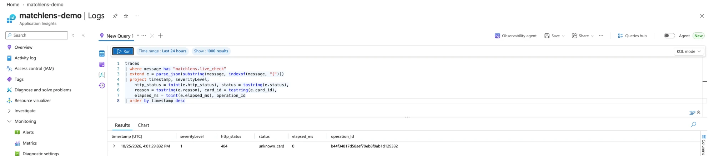

# Deployment and Microsoft integration

Status (2026-10-24): **public demo live on Azure Static Web Apps at <https://wonderful-hill-04967dd0f.5.azurestaticapps.net/> (with the live-check API) and on GitHub Pages at <https://vbabenko97.github.io/matchlens-ai/> (static mirror).** Every step marked **[operator]** needs your account, credentials or approval.

| check | result |
|---|---|
| Pages deploy | `Deploy demo (GitHub Pages, fallback)` [run 39476401211](https://github.com/vbabenko97/matchlens-ai/actions/runs/39476401211) on `main` @ `e7dc926`: **success** (2026-10-20) |
| `PUBLIC_DEMO_URL` | set to `https://vbabenko97.github.io/matchlens-ai/` (operator) |
| Public smoke test (Playwright e2e against the URL) | [run 1](https://github.com/vbabenko97/matchlens-ai/actions/runs/39478441723) (manual, 2026-10-20) and daily scheduled runs [2](https://github.com/vbabenko97/matchlens-ai/actions/runs/39604056321), [3](https://github.com/vbabenko97/matchlens-ai/actions/runs/39783144846), [4](https://github.com/vbabenko97/matchlens-ai/actions/runs/39955061358) (2026-10-21 to 2026-10-23): **all success**. The `pytest -q -m e2e` step ran in each run and was not skipped. Verified via the GitHub Actions API on 2026-10-24. |
| Manual replay test of the public URL | **passed** (operator-reported, 2026-10-24) |
| Redeploy with accessibility pass | [run 40081567480](https://github.com/vbabenko97/matchlens-ai/actions/runs/40081567480) on `main` @ `2731814`: build, deploy and post-deploy smoke **success** (2026-10-24 09:21 UTC) |
| Redeploy with cache-busting | [run 40082219742](https://github.com/vbabenko97/matchlens-ai/actions/runs/40082219742) on `main` @ `0aa672c`: build, deploy and post-deploy smoke **success** (2026-10-24 09:30 UTC) |
| Azure Static Web Apps | **deployed** (operator created `matchlens-demo` in `rg-matchlens-demo`); from `main` @ `14f1b88` by [run 40118847924](https://github.com/vbabenko97/matchlens-ai/actions/runs/40118847924), deploy and smoke **success**. The managed API builds on Python 3.11. GitHub Pages stays the static mirror. |
| Deploy of both hosts (2026-10-26 11:46 UTC) | `main` @ `6629d39`: Azure Static Web Apps [run 40317570596](https://github.com/vbabenko97/matchlens-ai/actions/runs/40317570596) and GitHub Pages [run 40317574235](https://github.com/vbabenko97/matchlens-ai/actions/runs/40317574235), deploy and smoke **success** |
| Deploy of both hosts (2026-10-26 17:22 UTC) | `main` @ `296eb06` (PR #40, bug fixes before the video): Azure Static Web Apps [run 40367964384](https://github.com/vbabenko97/matchlens-ai/actions/runs/40367964384) (smoke: 64 passed, 6 skipped) and GitHub Pages [run 40367968855](https://github.com/vbabenko97/matchlens-ai/actions/runs/40367968855) (smoke: 65 passed, 5 skipped), deploy and smoke **success**. The three new browser tests, which fail on the old `app.js`, pass against both public URLs. |

Both hosts serve the same static export. The Pages mirror never calls Azure. On the Azure host the page calls Azure only through the live-check button (`/api/live-check`, server side); everything else replays recorded runs. Re-run the deploy workflows after merges that change the UI or the bundle.

## What gets deployed
The public demo is the **static export** of the replay UI, built by both deploy workflows with the recorded Foundry runs:
```bash
python -m matchlens export-site --offline \
  --agent-trace docs/evidence/agent-trace-2026-10-24.json \
  --personalize-trace docs/evidence/personalize-trace-v2-2026-10-24.json \
  --editorial-review docs/evidence/personalize-review-v3-2026-10-25.json --out site
```
The Azure workflow adds `--live-api`, which shows the live-check buttons. The export has:
- `index.html`, `app.js`, `style.css`;
- `data/bundle.json` (precomputed seed-1 match, cards and metrics);
- `data/overlays.json`;
- `data/matches.json` (the match picker's index) and `data/matches/<match_id>.json` plus `-overlays.json` for the extra matches (seeds 121, 106, 103, 123, 124; offline, untuned; `--single-match` leaves them out).

Apart from those buttons, it runs entirely in the browser, needs no server code or account, and contains **no credentials**. Its card wording comes from the deterministic offline template, labelled as such. On the demo match, the claim checks and the language and club variants of the fan cards replay the recorded Foundry runs; the five extra matches have no AI output. It therefore stays fully functional without Azure, and hosting costs nothing beyond the free tier.

Caching: GitHub Pages serves assets with a 10-minute cache. `index.html` therefore loads `style.css?v=<hash>` and `app.js?v=<hash>` (content hashes added by `export-site`), so a new deploy never pairs new HTML with old cached CSS/JS. `bundle.json` is fetched with `cache: "no-cache"`.

Security on static hosts:
- `index.html` carries a CSP meta tag (`script-src 'self'`, no inline script or eval).
- Azure Static Web Apps additionally applies the headers in `deploy/azure-static-web-apps/staticwebapp.config.json` (CSP incl. `frame-ancestors 'none'`, `nosniff`, `no-referrer`).

## Option A (in use, primary host): Azure Static Web Apps — Free plan
Workflow: `.github/workflows/deploy-swa.yml` (manual `workflow_dispatch` only). It builds the export, copies `staticwebapp.config.json`, uploads with `Azure/static-web-apps-deploy@v1`, then runs the Playwright smoke suite against the returned URL.

Operator steps:
1. **[operator]** Azure portal → *Create a resource* → **Static Web App**. Choose:
   - **Plan type: Free**;
   - any resource group and region;
   - **Deployment source: Other**, so Azure does not add its own workflow to the repo.
   The Free plan has no hosting charge.
2. **[operator]** In the new resource → *Manage deployment token* → copy it, then in GitHub add it under *Settings → Secrets and variables → Actions → New repository secret* as `AZURE_STATIC_WEB_APPS_API_TOKEN`.
3. **[operator]** *Actions → Deploy demo (Azure Static Web Apps, Free) → Run workflow* on `main`.
4. **[operator]** Optional: set the repository **variable** `AZURE_DEMO_URL` (not a secret) if the site URL changes. The daily smoke test checks this host and `PUBLIC_DEMO_URL`, and defaults to `https://wonderful-hill-04967dd0f.5.azurestaticapps.net/`.

## Option B (in use, static mirror): GitHub Pages
Workflow: `.github/workflows/deploy-pages.yml` (manual only). It builds the same export, deploys with `actions/deploy-pages`, then runs the Playwright smoke suite. The repository is public, so Pages is free.
1. [x] **[operator]** *Settings → Pages → Build and deployment → Source: **GitHub Actions***.
2. [x] **[operator]** *Actions → Deploy demo (GitHub Pages, fallback) → Run workflow* on `main` (done 2026-10-20).
3. [x] **[operator]** Set `PUBLIC_DEMO_URL` to `https://vbabenko97.github.io/matchlens-ai/`.

The UI uses only relative URLs, so it works under Pages' `/matchlens-ai/` sub-path. This is covered by the e2e `static-subpath` target.

## Availability through 2026-11-10
- Neither host expires a Free/Pages site.
- `.github/workflows/public-smoke.yml` runs the full Playwright suite against `PUBLIC_DEMO_URL` daily (07:23 UTC) through 2026-11-10. A failure emails the repository owner (GitHub's default for scheduled-workflow failures). It skips when the variable is unset.
- Do not disable Pages or make the repository private before 2026-11-11.

## Testing the public URL with Playwright
The same e2e suite runs against a public URL; the expected data is read from the deployment's own `data/bundle.json`:
```bash
pip install -e ".[dev,e2e]" && python -m playwright install chromium
MATCHLENS_BASE_URL=https://<public-url>/ python -m pytest -q -m e2e
```
Verified locally against independent static hosts: the app server, a plain static server under a sub-path, and a separately hosted export via `MATCHLENS_BASE_URL`. The public URL `https://vbabenko97.github.io/matchlens-ai/` passes the same suite in the scheduled smoke workflow (see the status table above).

## Personalizer run (language and club variants) — operator step
**Status (2026-10-24): run recorded and wired in.** The operator recorded `docs/evidence/personalize-trace-2026-10-24.json` at 17:53 UTC (`gpt-4.1-mini`, Responses API v1).
- The run: 56 card runs, 62 calls (6 cards needed a retry), about 22K input / 6.8K output tokens.
- `trace_problems` passes and the file has no key-like strings.
- Both deploy workflows replay it with `--personalize-trace`.
- On replay, the stricter checker added after reading the run (score order, Russian-only letters) keeps 12 of 232 lines in English, among them "Eastvale Athletic перемагають 3-2" on a 2-3 scoreboard.
- **Superseded (2026-10-24, later):** the public builds now replay the v2 run with the critic (next section). This v1 run stays as the critic's evaluation input.

1. **[operator]** With the same `AZURE_OPENAI_*` variables as for `azure-check`, record all 8 variants of the 7 demo casual cards:
   ```bash
   python -m matchlens personalize-review --out docs/evidence/personalize-trace-<date>.json
   ```
   - That is 56 Responses API calls, plus one retry per card with a rejected line; at the recorded run's sizes, about 50K tokens in total.
   - The command prints every line with ✓ or "kept (reason)" and exits 1 without writing a file if the trace is not acceptable evidence.
2. Check the output (no key in the file: `grep -c "$AZURE_OPENAI_API_KEY" <file>` prints 0), commit it, then add `--personalize-trace <that file>` to the `export-site` lines of `deploy-pages.yml` and `deploy-swa.yml` (one PR), merge and redeploy.

## Critic agent runs (meaning review) — operator step
**Status (2026-10-24): both runs recorded and wired in.** The operator ran both in Azure Cloud Shell (`gpt-4.1-mini`, Responses API v1); `trace_problems` passes and neither file has key-like strings.
- `docs/evidence/critic-eval-2026-10-24.json` (19:23 UTC): 56 critic calls over 220 lines; against the 12 editorial rejections, 8 caught, 4 missed, 13 false alarms (recall 0.667, precision 0.381). `critic-eval --from` reproduces these numbers.
- `docs/evidence/personalize-trace-v2-2026-10-24.json` (19:40 UTC): 90 personalizer calls (35,444 in / 9,934 out tokens) and 89 critic calls (37,906 in / 7,620 out); 34 of 56 cards retried. Of 232 lines, 4 are kept by the checker and 10 by the critic. Replayed since the 56' move line was corrected (2026-10-26, "then 6 passes", not 7), the checker keeps 12: the 8 rewrites of that line still say 7.
- Its editorial review, `docs/evidence/personalize-review-v2-2026-10-24.json` (by Claude Code, not checked by a human), rejects 12 of the 218 accepted lines, so 26 of 232 lines show English.
- `docs/evidence/personalize-review-v3-2026-10-25.json` supersedes it. It keeps those 12 rejections and adds 18 more from a second AI review of the Ukrainian lines (ChatGPT, run by the operator; not checked by a human), so 44 of 232 lines show English.
- Both deploy workflows replay the v2 trace with the v3 review.

The steps, for a re-run. Two runs, with the same `AZURE_OPENAI_*` variables as for `personalize-review`. Both print what they find, and neither writes a file unless the run is acceptable evidence.

1. **Measure the critic against the editorial review** (about 56 calls, one per card variant, roughly 30K tokens):
   ```bash
   python -m matchlens critic-eval --out docs/evidence/critic-eval-<date>.json
   ```
   - It replays the recorded personalizer run, sends the lines that passed `check_line` to the critic (220 when the evaluation was recorded, 212 since the 56' move line was corrected), and compares the verdicts with the 12 rejections of the editorial review. That review was made by Claude Code, not a human, so the scores measure agreement with it. The critic's prompt names error categories only, with no examples from those lines.
   - It prints lines, caught, missed, false alarms, recall and precision, and each miss and false alarm.
   - `--from <file>` re-scores a recorded evaluation without a call.
2. **Record a new personalizer run with the critic in the loop:**
   ```bash
   python -m matchlens personalize-review --out docs/evidence/personalize-trace-v2-<date>.json
   ```
   - The critic is now on by default; `--no-critic` records the old v1 format.
   - Expect 56 personalizer calls, about 56 critic calls and one retry pair per card with a rejected line: roughly 130–170 calls and 60–80K tokens.
   - The trace is `matchlens.personalize-trace/v2` and holds the critic's verdicts and response IDs per attempt.

After the runs: the new trace gets its own editorial review, then the deploy workflows switch to it in one PR.

## Live Foundry check on the public demo (Azure Static Web Apps managed API)
On Azure Static Web Apps, each analyst card gets a **Check this card live with Microsoft Foundry** button. It sends `POST /api/live-check` with `{"card_id": ...}` and nothing else. The function in `api/live_check/` (code: `src/matchlens/live.py`) builds the request itself from the demo match and runs the same bounded agent and validator as `agent-review`. The reply replaces the recorded claim check on that card and is labelled as a live call, with response IDs, token use and latency. The key stays in the app settings; the browser never sees it. GitHub Pages builds have no button (no server side).

**Status: deployed and verified with one live call.**
- **Live call.** An independent review of `main` @ `ff20751`, after the deploy, reported one live call on the Azure host: 7.2 s, 3 model calls, 8,058 tokens, 4 claims verified by the validator.
- **Quota store.** A live reply also shows that `MATCHLENS_LIVE_COUNTER_URL` is set and the Table Storage reservation works: without it the API answers `not_configured` and makes no model call.
- **Forced `daily_limit` fallback (step 7): done by the operator on the previous deploy.** The API refused the call with `daily_limit` and the table's `Count` stayed at 2. Repeating it on `2b9da2a` would only re-check the same code after the update.
- **Re-check of tag `v1.0-submission` (`2b9da2a`), independent review:**
  - published HTML, JS, CSS and data match a build from the tag;
  - a fresh live request: HTTP 200, 8,051 tokens, 4 claims verified, 7.5 s on the server and 13.1 s end to end;
  - the API then reported `remaining_today: 1`, kept for the video.

Limits, in the order they apply:
1. Only the 7 analyst card IDs of the demo match are accepted, and any other field is a 400, so the endpoint cannot carry a free-text prompt. JSON POST only: a page on another site cannot call it from a visitor's browser. Scripts and `curl` can still call it directly; only the daily cap below limits them.
2. One live run at a time per instance; a second request gets "busy" and costs no quota. This protects capacity, not cost.
3. A courtesy limit of 3 checks per visitor per 10 minutes. It is kept in memory per instance and keyed by a hash of `X-Forwarded-For` / `X-Azure-ClientIP` / `X-Client-IP`. A script can forge these headers, so this is not a cost control.
4. **The spend cap is the shared daily count.** `MATCHLENS_LIVE_DAILY_LIMIT` (default 100) card checks per UTC day, counted in one Azure Table Storage entity per day (`src/matchlens/quota.py`).
   - A check is reserved before any model call, with an ETag-conditional write, so restarts and parallel instances never exceed the cap.
   - The reservation is kept even when the call fails.
   - If the table cannot be read or updated, or `MATCHLENS_LIVE_COUNTER_URL` is missing, no live call is made.
5. A 30 s deadline over all model calls, rate-limit waits included.

Whenever a check is not made or does not finish, the reply gives a reason (`not_configured`, `client_limit`, `daily_limit`, `counter_unavailable`, `busy`, `deadline`, `foundry_unavailable`). The page keeps the recorded run and says it is not a live call.

What the Azure-side settings do and do not do:
- **Budget:** an alert only. Azure budgets do not stop spending, and cost data arrives with a delay ([Microsoft Learn: budgets](https://learn.microsoft.com/en-us/azure/cost-management-billing/costs/tutorial-acm-create-budgets)).
- **Tokens-per-minute limit:** caps the request rate, not the total.
- **The daily count (4) is what bounds spend.** One check makes at most 24 generation requests: up to 6 per attempt, 2 attempts, and each request resent once when its answer is cut off. HTTP 429 and network retries can add more HTTP requests on top of these. The recorded run averaged ≈ 10K input / 0.5K output tokens per card. So 100 checks a day is about 1M input tokens, under $1/day at `gpt-4.1-mini` list prices (check current pricing). A check that uses every request costs more than this average; that worst case has not been measured.

Operator steps:
1. **[operator]** Create the **Free** Static Web App (Option A steps 1–2 above) and add `AZURE_STATIC_WEB_APPS_API_TOKEN`.
2. **[operator]** Create the shared quota store:
   - Create a Storage account (Standard, LRS; cost is cents a month), then *Storage browser → Tables → + Add table* `livechecks`.
   - Make a SAS for that table only: *Shared access signature* on the table with permissions **Read, Add, Update**, HTTPS only, expiring after the judging period (for example 2026-11-30).
   - Its URL looks like `https://<account>.table.core.windows.net/livechecks?sv=…&sig=…`. Treat it as a secret.
3. **[operator]** Static Web App → *Settings → Environment variables* (production):
   - `AZURE_OPENAI_ENDPOINT`, `AZURE_OPENAI_API_KEY`, `AZURE_OPENAI_DEPLOYMENT` (the same values as for `azure-check`);
   - `MATCHLENS_LIVE_COUNTER_URL` (the table SAS URL);
   - optionally `MATCHLENS_LIVE_DAILY_LIMIT`.
4. **[operator]** Foundry portal → the `gpt-4.1-mini` deployment → *Edit* → tokens-per-minute limit. The recorded run hit 13 HTTP 429s at the current limit; about 50K tokens per minute lets a check finish within 30 s. Change this only after the counter is verified (step 7).
5. **[operator]** Azure portal → *Cost Management → Budgets*: a monthly budget with an alert (for example $10), as an early warning.
6. **[operator]** *Actions → Deploy demo (Azure Static Web Apps, Free) → Run workflow*. The workflow copies `src/matchlens` into `api/matchlens` and uploads `api/` as the managed API. Its runtime is `python:3.11` (`staticwebapp.config.json`), which SWA managed functions list as supported ([Microsoft Learn: languages and runtimes](https://learn.microsoft.com/en-us/azure/static-web-apps/languages-runtimes)).
7. **[operator]** Verify in this order (each live call costs tokens):
   - **Live call:**
     ```bash
     curl -s -X POST https://<name>.azurestaticapps.net/api/live-check \
       -H 'Content-Type: application/json' -d '{"card_id":"analyst:goal:ml1-01206"}' | head -c 600
     ```
     Expect `"status":"live"`, response IDs, `usage`, `latency_ms` and `remaining_today`. The `livechecks` table should now hold today's row with `Count` 1.
   - **Fallback:** temporarily set `MATCHLENS_LIVE_DAILY_LIMIT` to the current `Count`. The same call must return `"reason":"daily_limit"` without a model call. Then restore it.
   - `not_configured` means step 3 is incomplete; `counter_unavailable` means the SAS URL is wrong, expired or lacks a permission.

Local run with your own key: `python -m matchlens serve --live-api` (reads the `AZURE_OPENAI_*` variables; uses the table if `MATCHLENS_LIVE_COUNTER_URL` is set, else an in-memory count, acceptable only on your own machine). `--offline` serves the button with `not_configured` replies. Tests use fake transports only (`tests/test_live.py`, the live-button e2e tests); the public smoke test never presses the button.

## Telemetry of the live check (Application Insights)
**Status (2026-10-25): connected and verified.** The Azure host runs `main` @ `0413ede` (deploy [run 40205864784](https://github.com/vbabenko97/matchlens-ai/actions/runs/40205864784), smoke included). The operator sent the free `telemetry-probe` request; query 1 showed it at 16:01:29 UTC: HTTP 404, `unknown_card`, severity 1 (Information), `elapsed_ms` 0, and no `card_id` ([screenshot](images/telemetry.png), cropped to leave out the account header). No live call has been recorded in Application Insights yet.



What is recorded:
- **One trace per `POST /api/live-check`**, refused or not (`log_telemetry` in `src/matchlens/live.py`). The message is `matchlens.live_check ` followed by JSON, schema `matchlens.live-telemetry/v1`:
  - every request: HTTP status, outcome (`live`, `fallback`, `unknown_card`, `bad_request`, …), fallback reason, error type, card ID (known cards only), time in the handler;
  - once a run starts, live or not: model calls answered, input and output tokens, HTTP 429 answers. These are counted at the transport, so a run that hits the deadline still reports what it spent;
  - a live run also adds: agent latency, deployment, claims proposed and rejected per attempt, facts published, response IDs (to find a call in Foundry), checks left today.
- **Never recorded:** the API key, the endpoint, the client address or its hash, the request body, claim text. A request with an unknown card ID is logged without that ID, so a request cannot write text of its own into the logs. Application Insights itself does not store client IP addresses by default: it uses them for a geolocation lookup and writes `0.0.0.0` ([Microsoft Learn: IP handling](https://learn.microsoft.com/azure/azure-monitor/app/ip-collection)).
- **Severity:** Warning for server-side failures (HTTP 5xx: `not_configured`, `busy`, `deadline`, `foundry_unavailable`; and `counter_unavailable`, answered 429). Information for everything else, including the `daily_limit` refusal: the cap doing its job is not a fault.
- **`api/host.json`:** the default level stays Warning (no runtime chatter). `Host.Results` is at Information, so the `requests` table gets every call with its duration and result code. `Function.live_check.User` is at Information, so the telemetry lines get through ([Microsoft Learn: configure categories](https://learn.microsoft.com/azure/azure-functions/configure-monitoring#configure-categories)). Adaptive sampling stays at its default and engages only above about 20 items per second per host, far above this demo's traffic. The table count, not telemetry, stays the authoritative spend count.

Operator steps:
1. **[operator]** Connect Application Insights. Done on 2026-10-25 as follows:
   - The documented way is the Static Web App's **Application Insights** page → *Enable Application Insights*: **Yes** → **Save** ([Microsoft Learn: monitor Static Web Apps](https://learn.microsoft.com/azure/static-web-apps/monitor)). On this Free-plan app it did not stay saved: the page fell back to **No** and no resource was created. The cause was not investigated (the Static Web App's *Activity log* would name it).
   - What worked: create the Application Insights resource `matchlens-demo` by hand (*Application Insights → Create*, resource group `rg-matchlens-demo`, East US 2, the default Log Analytics workspace). Then add two variables under the Static Web App's *Settings → Environment variables* (production): `APPLICATIONINSIGHTS_CONNECTION_STRING` (the resource's *Connection String*) and `APPINSIGHTS_INSTRUMENTATIONKEY` (its instrumentation key). These are the app settings the toggle would have written. The values stay out of git and screenshots.
   - Cost: Application Insights is billed separately from Static Web Apps, by data ingested. Each request writes one request record and one trace, a few kilobytes at most. Optionally set a daily cap under *Usage and estimated costs* in the new resource.
2. **[operator]** *Actions → Deploy demo (Azure Static Web Apps, Free) → Run workflow* on `main`, so the new `host.json` and code are live.
3. **[operator]** Free check (no model call, no quota):
   ```bash
   curl -s -X POST https://wonderful-hill-04967dd0f.5.azurestaticapps.net/api/live-check \
     -H 'Content-Type: application/json' -d '{"card_id":"telemetry-probe"}'
   ```
   Expect `"status":"unknown_card"` (HTTP 404). After a few minutes, query 1 in [telemetry.kql](telemetry.kql) shows that request with `status` `unknown_card` and an empty `card_id`. Open *Application Insights → Monitoring → Logs*. If the page opens an **Agent** chat, switch the *Agent* toggle off and choose **KQL mode**.
4. **[operator]** The next live call (for example the one in the video) appears with `status` `live`, its tokens, its claims rejected per attempt and its response IDs. Queries 2 and 3 give the daily view and the fallback reasons; query 4 puts the host's request record next to each line; query 5 lists the live checks of the last 30 minutes, one row each, for a screen (the video's telemetry shot).
5. **[operator]** Evidence for the judges: a screenshot of query 1 (`docs/images/telemetry.png`, 2026-10-25, the probe). README and SUBMISSION list Application Insights as in use since then. Optional: retake it after the video's live call, so it shows a `live` row with tokens and claims.

If nothing appears after about 10 minutes: run `traces | where timestamp > ago(1h) | project timestamp, message, customDimensions.Category | take 50`. If the `matchlens.live_check` lines are missing but other traces arrive, the Functions host files them under another category: raise that category to Information in `api/host.json`.

## Microsoft Foundry / Azure OpenAI inference
- **Code path:** `src/matchlens/narrative.py` (`AzureOpenAIProvider`), Responses API v1 (`/openai/v1/responses`), configured by the three `AZURE_OPENAI_*` variables in `.env.example`. Real values live only in your shell or a secret store.
- **Strict check:** `python -m matchlens azure-check` (one call, no fallback, redacted evidence).
- **Checklist:** [docs/AZURE_VERIFICATION.md](AZURE_VERIFICATION.md).
- **Status (2026-10-24): verified.** `azure-check` made one live Foundry Responses API v1 call to the `gpt-4.1-mini` deployment: `status: completed`, 137 input / 41 output tokens, `store: false`. The redacted report is [evidence/azure-check-2026-10-24.json](evidence/azure-check-2026-10-24.json). Mocked tests do not count as evidence.

The browser never holds a key. The Azure host's live check calls Foundry server side through `/api/live-check`, and every other AI output on the page replays a recorded run: the claim agent trace, and the personalizer trace with its editorial review.

## Credentials inventory (no values in git)
| item | status |
|---|---|
| Azure subscription | **active** (hosts the Foundry deployment) |
| Static Web App (Free) + `AZURE_STATIC_WEB_APPS_API_TOKEN` secret | **created and in use** |
| GitHub Pages source = GitHub Actions | **enabled**; site deployed |
| Foundry / Azure OpenAI model deployment + key | **created** (`gpt-4.1-mini`), verified by `azure-check` 2026-10-24; key held by the operator only |
| `PUBLIC_DEMO_URL` repository variable | **set** to `https://vbabenko97.github.io/matchlens-ai/` |
| Application Insights `matchlens-demo` + its connection string in the Static Web App's environment variables | **created and connected** 2026-10-25; values held in Azure only |

## Operator decisions
- 2026-10-20: Azure Static Web Apps Free preferred, GitHub Pages fallback. No paid resources without approval.
- 2026-10-20: Configuration stays environment-based. Credentials are never committed, logged or shown.
- 2026-10-24: hosting settled on GitHub Pages; no Static Web App will be created.
- 2026-10-24 (later): the Free Static Web App was created after all and became the primary host, with the live-check API; GitHub Pages stays the static mirror.
- 2026-10-25: Application Insights connected to the Static Web App for live-check telemetry (billed by data ingested).
